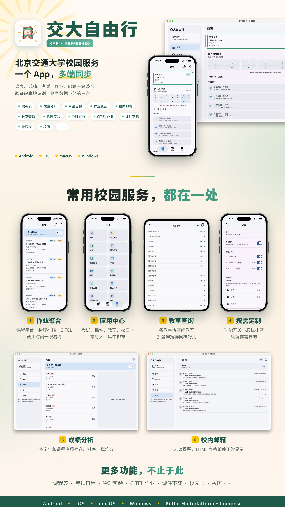

# 🚄 交大自由行KMP (BJTU Self Service KMP Refreshed)

> 北京交通大学校园服务客户端 —— 让校园生活触手可及  ↩
> 本仓库为 **Kotlin Multiplatform 重构版**（Android / iOS / macOS / Windows）。

[](https://github.com/JasonZhang1225/BJTUselfService-KMP-Refreshed/releases)
[](https://developer.android.com)
[](https://developer.apple.com)
[](https://developer.apple.com)
[](https://kotlinlang.org)
[](LICENSE)

<p align="center"></p>

## 📖 项目简介

**交大自由行** 是一款专为北京交通大学师生打造的校园服务应用。通过自动登录 MIS 系统，将成绩查询、课程表、考试安排、作业管理、邮件查看等常用校园功能整合到一个简洁直观的界面中。

登录页解析、密码加密和学校数据解析均在**本地完成**，账号密码不会上传至第三方服务器。

本项目（[BJTUselfService-KMP-Refreshed](https://github.com/JasonZhang1225/BJTUselfService-KMP-Refreshed)）在原作者 [HFDLYS/BJTUselfService](https://github.com/HFDLYS/BJTUselfService) 安卓版基础上，用 **KMP + Compose Multiplatform** 做多端共享实现。

本项目以原版 `v1.7.1` 为迁移基线，此后独立迭代，不再与上游同步。相对迁移基线，KMP 版主要新增：

- **四端共享**：Android / iOS / macOS / Windows 共用业务逻辑与大部分界面
- **更多作业来源**：物理在线、CITEL（书面作业 + 编程练习），可与课程平台聚合为一个“作业”入口
- **物理实验与演示实验**、**图书馆借阅**
- **桌面小组件、灵动岛与实时活动**（iOS 灵动岛 / Android 16 实时动态）
- **本地 AI 助手与 ChatGPT 插件**：用 AI 工具查询课表、成绩、作业
- **应用中心与可自定义底栏**

## 📱 支持平台

- **Android**：arm64-v8a `.apk`，Android 9.0 及以上（包名 `team.bjtuss.bjtuselfservice.kmp`，与原版包名不同，可共存）
- **iOS**：unsigned `.ipa`，iOS 18.0 及以上（需自行签名侧载，可使用 SideStore；签名时须保留 App 扩展，否则小组件无法读取课表。参考 [iOS 自签与安装指南](docs/iOS-sign-guide.md)）
- **macOS**：arm64 `.dmg`，macOS 12 及以上（仅支持 Apple Silicon 芯片 Mac，ad-hoc 签名，未公证，首次打开可能需要在终端执行 `sudo xattr -r -d com.apple.quarantine /Applications/交大自由行\ KMP.app`）
- **Windows**：x64 `.msi` 安装包
- 对于其他系统平台或架构，可以使用源码自行打包对应平台版本

### 🔐 智能登录

- iOS 和 Mac 可以调用系统“密码” App，选择 MIS 网页密码自动填充登录
- 免验证码自动登录 MIS 系统
- 学校要求验证码时显示图片，可刷新后手动输入；自动登录只提交一次密码，失败即停下，避免重复提交
- 登录状态持久化，打开即用
- 物理实验、演示实验、物理在线和 CITEL 需要单独配置账号密码，支持记住密码和自动登录

### 📚 学业管理

- **成绩查询** — 查看成绩详情，按学年、课程类型（选修/必修等）筛选、排序、计算均分
- **课程表** — 直观的课程表预览界面，支持本科生与研究生
- **考试日程** — 考试安排一览，变动自动提醒
- **智慧课程平台作业与课件** — 查看、筛选、排序作业，支持作业上传与下载；课件可单个下载或整课批量导出
- **物理实验与物理演示实验（需单独配置账号密码，需校园网）** — 获取物理实验选课信息和已预约的演示实验，并显示在首页和课程表
- **物理在线作业管理（需单独配置账号密码，需校园网）** — 查看课程、作业安排、批改信息和评语；保存作业文件并最终提交
- **CITEL 作业（需单独配置账号密码）** — 同步书面作业与编程练习，支持报告文件增删替换和代码文件提交；查看折扣倍率及开始/折扣/截止节点；编程题显示评测结果，题面与测试用例可复制或保存为 Markdown，也可导出为文件夹
- **作业聚合与搜索** — 课程平台、物理在线和 CITEL 默认合为一个“作业”入口（可在设置中分开）；支持搜索全部作业，不受筛选条件限制

### 📬 信息服务

- **校内邮箱** — 首页显示未读邮件数量，邮件展示支持 HTML 表格，支持写信/回复、附件查看与保存和在浏览器打开
- **完美校园与校园网缴费** — 二维码弹窗，可保存二维码后用微信扫一扫进入；Android 另可直接打开完美校园 App

### 📅 日历与提醒

- 按照校历获取教学周安排，可正确处理国庆等长假导致的教学周变动
- 课程表页面支持将课程表和物理实验导入手机日历（直接导入仅支持iOS，安卓支持导出为.ics文件）
- 首页展示正在进行和即将开始的课程，以及 48 小时内截止的作业（含物理在线和 CITEL）；数据变动按来源弹窗提醒
- 第二节在逸夫教学楼、思源西楼的课按错峰时间（10:30–12:20）显示，可在设置中关闭
- **桌面小组件**（iOS / Android）：“临近课程”“今日课程”“本周课表”三种，支持浅色/深色
- **灵动岛与实时活动**：
  - iOS 上日程可以显示在灵动岛和实时活动里，并支持 Apple Watch 智能叠放。
  - Android 16 及以上支持课程实时动态（Live Updates），在 HyperOS 等系统上会以灵动岛样式显示。
  - 课前会准点出现，可以在「正在上课」或「即将上课」卡片上调整出现时间。

### 🏫 校园工具

- **教室占用查询与人数估计** — 查看教务系统的教室占用和第三方接口的教室人数侦测结果；突出显示当前节次并列出空闲教室
- **图书馆借阅** — 统一认证登录后查看当前借阅与借阅历史，支持单本/批量续借，首页提供到期与逾期提醒
- **校历** — 打开公众号文章查看学校最新校历
- **成绩单下载** — 支持中英文成绩单快捷下载
- **应用内更新** — 支持 GitHub / Gitee 双更新源，可在设置中选择；自动模式优先连接 GitHub，失败时切换 Gitee。

### 🤖 AI 助手

- **本地 AI 助手** — 可接入 Codex、Claude Code、WorkBuddy 等工具（Skill + CLI），在电脑上让 AI 读取本机缓存的课表、作业、考试、成绩和邮件
- **ChatGPT 插件** — 借助付费 ChatGPT 账号的 Sites 功能创建私人插件，即可用 ChatGPT 远程查询课表、成绩、作业等信息。数据由你自己的设备上报：手机每次刷新时上报；电脑可在后台定时同步，也可关闭后台同步，只在应用内刷新时上传

### 🖥️ 电脑端

- 支持开机启动、后台运行和静默启动
- Windows 点关闭按钮可收进托盘，最小化为普通最小化

## 🔒 隐私与安全

- ✅ 验证码在本地显示、由你手动输入，**不上传任何数据到第三方服务器**
- ✅ SSO 登录页面解析与密码加密在客户端完成（本地 SM2）
- ✅ 账号密码仅存储在本地设备
- ✅ 学业数据通过学校服务查询；教室人数与占用详情通过学校/项目服务获取，不上传账号密码
- ✅ Android Keystore、Apple Keychain、Windows DPAPI 保存登录凭据
- ✅ macOS/Windows 离线缓存字段使用系统密钥支持的 AES-256-GCM 加密

### 🗑️ 卸载与本地数据清理

- **Android / iOS**：卸载即清除应用私有数据；缓存数据库已设置不随 iCloud/iTunes 备份上云。

- **Windows**：MSI 卸载会自动删除 `%LOCALAPPDATA%\BJTUselfServiceKMP`（离线缓存）和 `HKCU\Software\JavaSoft\Prefs\team\bjtuss\bjtuselfservice`（DPAPI 加密凭据）；升级安装不会清除数据。

- **macOS**：拖拽删除 `.app` **不会清除用户数据**。卸载前请在应用内「设置 → 本地数据与会话 → 清除全部本地数据」执行全量清理；如已删除应用，可手动删除：

  - `~/Library/Application Support/BJTUselfServiceKMP/`（AES-256-GCM 加密离线缓存）
  - 「钥匙串访问」中服务名为 `team.bjtuss.bjtuselfservice.kmp.secrets` 的条目（登录凭据、缓存密钥、物理实验账号等合并为一条）
  - 旧版分条名称 `team.bjtuss.bjtuselfservice.kmp.credentials`、`…cache-key`、`…physicslab` 会在新版首次成功读取后迁入上一条并删除
  - `~/Library/Preferences/` 下 `team/bjtuss/bjtuselfservice` 相关的偏好文件（记住密码标记）

本项目经过了多轮专门的安全审计与修复，使用不低于 GLM5.3 和 GPT Sol 5.6 的前沿模型。安全审查和修复文档记录见 [安全文档](docs/security)。

## 🏗️ 技术架构

**原安卓工程（迁移基线 `v1.7.1`）** 已于 1.8.6 从本仓库移除，完整快照存档在标签 [`archive/legacy-android-and-captcha-model`](https://github.com/JasonZhang1225/BJTUselfService-KMP-Refreshed/tree/archive/legacy-android-and-captcha-model)；技术栈为 Jetpack Compose + Material 3、Dagger Hilt、Room、OkHttp3 + Jsoup、Bouncy Castle (SM2)。原版后续的架构与依赖见[原版 README](https://github.com/HFDLYS/BJTUselfService#readme)。

**KMP 刷新版（`multiplatform/`）** 共享业务与大部分 UI：

```
┌─────────────────────────────────────────────┐
│              UI（Compose Multiplatform）      │
│  Android / iOS / macOS / Windows 共享 Screen + 壳层 │
├─────────────────────────────────────────────┤
│           shared 领域 / 仓库 / 登录协议        │
│  SQLDelight 缓存 · 平台 Keystore/Keychain     │
│  Ktor + 各平台引擎 · HTML 解析                 │
└─────────────────────────────────────────────┘
```

### 主要依赖（KMP）

| 类别   | 技术                                            |
| ---- | --------------------------------------------- |
| UI   | Compose Multiplatform + Material 3            |
| 网络   | Ktor                                          |
| 本地缓存 | SQLDelight                                    |
| HTML 解析 | Ksoup                                       |
| 序列化  | kotlinx.serialization                         |
| 凭据   | Android Keystore / Apple Keychain / Windows DPAPI |
| 宿主   | androidApp · iosApp · desktopApp · windowsApp |

## 🚀 从源码快速开始

### 环境要求

- JDK 21+（推荐 Android Studio 自带 JBR 21 或本机 Temurin）
- Android SDK（minSdk 28，即 Android 9.0）
- Xcode（构建 iOS，最低部署版本 iOS 18.0）
- Apple Silicon macOS（Desktop 当前 arm64 自包含包）

### 构建步骤（KMP）

```bash
# 1. 克隆本仓库
git clone https://github.com/JasonZhang1225/BJTUselfService-KMP-Refreshed.git
cd BJTUselfService-KMP-Refreshed

# 2. 进入 multiplatform 工程
cd multiplatform
chmod +x gradlew

# 3. Android debug
./gradlew :androidApp:assembleDebug

# 4. macOS DMG（Apple Silicon）
./gradlew :desktopApp:packageDmg

# 5. Windows MSI（需在 Windows x64 上执行）
./gradlew :windowsApp:packageMsi

# 6. iOS 未签名构建（之后打成 IPA 自签侧载，流程见 .github/workflows/kmp-package.yml）
xcodebuild -project iosApp/iosApp.xcodeproj -scheme iosApp -configuration Release \
  -destination 'generic/platform=iOS' CODE_SIGNING_ALLOWED=NO build
```

### 仓库与发布

- 本仓库：[JasonZhang1225/BJTUselfService-KMP-Refreshed](https://github.com/JasonZhang1225/BJTUselfService-KMP-Refreshed)（四端发布见 [Releases](https://github.com/JasonZhang1225/BJTUselfService-KMP-Refreshed/releases)，各版本说明见 [docs/releases](docs/releases)）
- Gitee 镜像与下载：[Gitee Releases](https://gitee.com/zjg1225/BJTUselfService-KMP-Refreshed/releases)。
- 原版安卓：[HFDLYS/BJTUselfService](https://github.com/HFDLYS/BJTUselfService)

## 🤝 贡献者

感谢上游项目与以下所有为本项目做出贡献的朋友们：

- [HFDLYS](https://github.com/HFDLYS)
  - 原版开发者，项目起源
- [optsimauth](https://github.com/optsimauth)
  - 重构了整个项目的架构，优化了代码结构，以及后续若干跟进
  - 开发 [BJTUselfServiceAIO 社区版](https://github.com/optsimauth/BJTUselfServiceAIO)；本项目首页课表的展示、教室查询整合和可配置底栏的改造，参考了该项目的功能与交互设计
- [guh0613](https://github.com/guh0613)
  - 提供自动构建与发布
- [carolyn-sun](https://github.com/carolyn-sun)
  - 优化了工作流配置
- [NAPH130](https://github.com/NAPH130)
  - 修复若干 bug
- [B-Silva20](https://github.com/B-Silva20)
  - 提供了成绩自选课程计算
  - 图书馆借阅
- [wangxiaobo1747](https://github.com/wangxiaobo1747)
  - 提供了自定义壁纸和桌面课程表小组件
- [Peterloses](https://github.com/Peterloses)
  - 优化底部导航、壁纸和玻璃态界面，改进课程表小组件
- [Dontplay0112](https://github.com/Dontplay0112)
  - 修复研究生获取课表时崩溃的问题
- [lsr0LSR](https://github.com/lsr0LSR)
  - 修复作业上传接口
- [Vannnesa](https://github.com/Vannnesa)
  - 重构应用界面，实现原生邮箱与教室规划，新增课程高亮及过期考试样式
- [JasonZhang1225](https://github.com/JasonZhang1225)
  - KMP 多端迁移（Android / iOS / macOS / Windows）、物理在线、物理实验、CITEL、新版SSO、ChatGPT插件等
