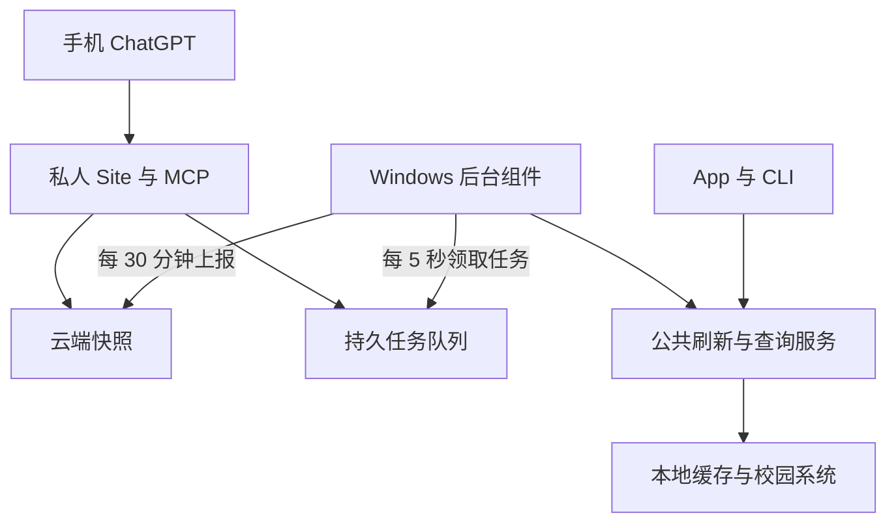

# Agent Remote 改造计划

> 日期：2026-10-21（北京时间）。
> 集成分支：`agent-remote`，基于用户刚合并 PR #34、#35 后的 `main@f454d3a5cf15`。
> 状态（2026-10-21 更新）：计划 PR 1–6 的基本实现已齐，按用户要求将原分支历史与后续改动整理为一个基本实现提交；全部在主目录本地 `agent-remote`，不再使用开发工作树。私人 Site 和同一 canonical 插件 1.0.2 已发布，真实安装版配对、快照与远程刷新自动反馈已通过；用户 ChatGPT 测试反馈的物理在线 DDL 漏项仍待定位，不宣称完整验收通过。证据见 `windows-local-verification-2026-10-21.md` 与 `memory.md`。
> owner-private 机器访问、实际安装版配对和真实账号同步已验证；远程同步仍默认关闭，由用户确认范围后开启。技能以工具返回的已处理日期时间为准，不重复前移/后移截止日期。
> 共享测试 996 项（沿用 Windows 环境既有 5 项排除）、Windows/桌面/Android 共享代码编译、Node 36 项及 MSI 打包通过；新 MSI 升级、托盘/开机启动、连续周期、手机正确性和 Apple 原生构建仍待验收。
> 本计划接续 `ai-agent-plan.md`；现有 CLI 和本机 Skill 保留，下面的刷新语义在实现后替代旧计划的相应限制。

## 1. 目标与确定的默认行为

让用户在校园网 Windows 上登录交大自由行、完成一次远程配对后，即可在手机 ChatGPT 查询自己的校园数据。其他用户可从同一份模板创建各自的私人 Site 和插件，绑定自己的电脑与学校账号。

| 项目 | 确定行为 |
| --- | --- |
| 定时上报 | Windows 每 30 分钟向 Site 上报一次数据；间隔可改 |
| 定时数据新鲜度 | 默认在上报前执行一轮全量刷新，再生成快照；失败来源保留旧数据及原同步时间，禁止用本次上传时间伪装最新 |
| 指令检查 | Windows 每 5 秒向 Site 检查待执行指令；间隔可改；没有指令就不查询学校 |
| 普通手机查询 | 优先直接读 Site 快照；通常半小时更新足够，不因每次提问或缓存变旧就自动要求 Windows 刷新 |
| 即时查询 | 用户明确要求实时、最新、刷新，或请求云端未存的具体详情时，Site 才创建有明确范围的任务 |
| App 与 CLI 同时运行 | CLI 发起请求，App 统一执行一次正常刷新，UI、缓存和结果保持一致 |
| 全量刷新 | `cache update` 默认刷新全部已启用且已配置的数据源；不再只覆盖四类 |
| 网络方向 | Windows 主动连接 Site；无需寝室公网 IP、入站端口或内网穿透；Site 不直接登录学校 |
| 分发 | 每人一个自己拥有的私人 Site；模板共享代码，运行数据和设备凭据不共享 |
| 首版宿主 | Windows 常驻后台组件；macOS 保持本机 CLI 兼容，远程常驻适配以后单独做 |

“每 30 分钟上报”按上述“先刷新、再上报”落地，避免只重复上传陈旧缓存。启动、恢复联网时可上报当前快照；若已到刷新周期再补一轮刷新，不追补离线期间所有周期。

本期只读学校业务数据；不增加提交作业、提交代码、发邮件、选课、缴费和任意远程 shell。邮箱未读等可参与本机全量刷新，是否上传由独立的数据范围开关决定。

## 2. 当前代码依据

以下均已在本次分支基线核对，不把旧计划当作现状：

- `shared/src/commonMain/.../feature/shell/AuthenticatedAppShell.kt`：已有 `refreshGlobal`，覆盖首页、邮箱未读、课程平台作业、考试、课表、成绩、已启用的物理在线、CITEL、物理实验和演示实验；编排仍依赖 Compose 生命周期。
- `shared/src/commonMain/.../feature/shell/AuthenticatedSessionFactory.kt`：在 `rememberAuthenticatedSession` 内装配 Repository/ScreenModel；需要提取可在 Compose 外使用的业务组合根，不能复制第二套同步协议。
- `shared/src/desktopMain/.../agent/AgentCacheUpdate.kt`：目前拿不到 `app-running.lock` 就返回 App 正在运行；不支持给 App 发刷新请求。
- `shared/src/commonMain/.../agent/AgentSync.kt`：后台同步仅覆盖 `grades/courses/homework/exams`。
- `shared/src/desktopMain/.../agent/AgentCli.kt`：已有只读缓存、JSON 输出、既有数据库版本和密钥校验。
- `windowsApp/src/windowsMain/.../Main.kt`、`WindowsAgentCli.kt`：已有 Windows headless CLI 入口、DPAPI 凭据与缓存密钥接入。
- `shared/src/commonMain/.../agent/AgentSkill.kt`：已有本机 `bjtuss` Skill，包含时区、零点截止、实验预约过滤、CITEL 状态等规则；旧的“App 开着拒绝刷新”和“部分来源仅 App 可刷新”需在实现后更新。
- `shared/src/commonMain/.../feature/shell/AppCommand.kt`：现有命令总线只有当前页刷新，没有跨进程请求、全局刷新回执或任务结果。

上述路径均相对于 `multiplatform/`。学校侧智慧教学旧 CAS 跳转 404、教务临时不可达是现有阻塞；远程接入不负责修学校服务，也不把这些失败误判成远程链路失败。

## 3. 结构与职责



### 3.1 公共刷新服务

- 用普通 Kotlin 工厂构造数据依赖；Compose 只负责订阅状态和呈现交互。
- App 按钮、CLI、周期任务和远程任务调用同一协调器；发起来源记录为 `app/cli/scheduled/remote`，不改变学校协议。
- 同一设备、学校账号、数据源只有一个有效刷新执行者；相同请求合并等待，部分重叠请求复用已有工作并补齐缺失来源。
- 保留现有学校请求串行语义和必要依赖，不把全部接口无条件并行化。一个数据源失败不阻断独立来源。
- 进度和最终报告逐源区分 `success/failed/skipped/needs_user_action`，携带原数据同步时间；取消和超时必须收口。
- 账号切换、退出登录时取消旧账号任务，不能把旧任务结果写进新账号缓存或继续上传。

### 3.2 桌面进程协调

- App 开着：CLI/后台组件通过经过认证的本机 IPC 把请求交给 App；复用 App 当前会话，UI 显示同一轮进度。
- App 未开：后台宿主以无窗口方式构造同一套业务依赖。GUI 后续启动时，经过所有权交接或请求代理，不能另建一个互相顶会话的同步执行者。
- PR 2 先验证两种宿主切换，再确定 Windows 命名管道或经过认证的 loopback IPC；macOS 用对应平台实现。IPC 不监听外部网卡。
- 保留跨进程互斥作为所有权保护，替换“有 App 锁就直接拒绝”的策略；不能简单删除锁。
- IPC 请求必须有 ID、长度上限、截止时间和结果回执。请求发出后 CLI 超时不能自动假定底层刷新未执行。
- Windows 后台组件使用用户自己的登录会话运行，以访问其 DPAPI 数据；首版不使用 LocalSystem 服务。
- 新刷新失败原因采用 JSON 可判定码；保留已有 CLI 查询和退出码兼容，新增码与旧 `APP_RUNNING=6` 的迁移写入命令参考。

### 3.3 全量刷新范围

| 范围 | 默认全量刷新 | 云端默认范围 |
| --- | --- | --- |
| 首页、课表、校历、考试、课程平台作业 | 包含 | 课表、考试、作业和日程的必要字段 |
| 物理在线、CITEL 任务、物理实验、演示实验 | 已启用且账号配置完成时包含 | 参与作业与日程的必要字段 |
| 成绩与课程性质 | 包含，复用本机规则 | 默认不上传，用户可单独开启 |
| 邮箱未读 | 按 App 当前正常刷新行为包含 | 默认不上传；正文不在首版自动快照范围 |
| 教室占用、课件、具体题面与测试用例 | 有明确上下文时按需查询 | 不做全校、全学期、全文件批量预抓取 |

“全量”指 App 正常全局刷新及其完整日程来源，不表示扫描所有教室、下载全部附件。新增来源必须登记数据范围、失败结果与同步时间。

## 4. 两条远程路径

### 4.1 周期快照

1. 用户启用远程功能并选择允许上云的范围；后台组件按 30 分钟周期发起全量刷新。
2. 从一致的本地快照生成经范围过滤的 JSON；请求 Site 写入最新完整版本。
3. Site 成功落库后确认版本。网络失败重传同一快照，不重复登录学校。
4. Site 查询读取已接收快照，返回每个来源真实同步时间、上传时间、失败原因和设备最近在线时间。

快照包含 `schemaVersion/deviceId/accountBindingId/snapshotId/sequence/generatedAt/uploadedAt/sources/scopes/data`。学校账号用本地绑定标识关联，不把密码、Cookie、令牌或数据库密钥作为快照字段。

- `generatedAt/uploadedAt` 与逐源 `fetchedAt` 分开；部分失败可形成包含新旧来源的快照，明确逐源版本。
- 同一设备绑定的单调序号防止旧上传覆盖新数据；重装或重新配对建立新的绑定代次。
- 默认只保存最新快照；任务结果默认 24 小时后清理，任务元数据默认 7 天后清理；清理在有界批次内进行，不依赖页面持续打开。
- 关闭某个上云范围后，下次上传主动移除云端对应字段；设备在线时同步权限修订，Site 立即按已收到的权限拦截。
- 用户可在私人 Site 直接暂停查询/撤销设备/清除云端数据；Windows 离线时，本地改设置无法瞬间通知云端，界面需说明。

### 4.2 精确即时指令

普通“明天有什么课”在 Site 快照中筛选，不创建任务。用户说“刚交的物理作业，查一下最新状态”，才创建有范围的即时查询任务。

| 操作 | 内容 | 是否访问学校 |
| --- | --- | --- |
| `query` + `freshness=local` | 读取 Windows 当前本地数据，按来源、课程、日期、任务 ID 筛选 | 否 |
| `query` + `freshness=latest` | 先刷新相关来源，再返回精确结果 | 是，仅相关来源 |
| `refresh_all` | 执行一次全量刷新并更新云端快照 | 是，全部启用来源 |
| `citel_problem` | 指定任务的题面/用例，遵守用户的数据范围与获取全文授权 | 需要新取时访问 |

参数是版本化 DTO 和枚举白名单，不接收任意命令、文件路径、脚本、URL 或 SQL。查询结果同样执行数据范围校验；不能通过即时查询绕过“成绩不上云”等开关。

任务字段至少有 `requestId/idempotencyKey/deviceId/accountBindingId/operation/arguments/createdAt/expiresAt/status/leaseId/leaseUntil/attempt`。

- 状态：`queued → running → succeeded/partial/failed`；未领取或租约耗尽后可标记 `expired`；撤销绑定使未完成任务失效。
- Site 原子领取并设置租约，任务 ID 与 lease ID 一起用于续租、提交结果；过期执行者不能覆盖新租约结果。
- 网络采用至少一次交付，依靠幂等和本地结果记录去重，不宣称绝对只执行一次。传结果失败重传结果，不直接重做学校刷新。
- 相同任务重复领取复用结果；多个任务请求相同来源时合并刷新。已在执行的读取可完成后丢弃失效结果，不承诺撤销能收回已发出的学校请求。
- MCP 创建任务后短时间内返回任务 ID，不长期占用一次工具调用。结果尚未完成就返回 `pending`，后续用状态工具读取，不能假报实时结果。
- 默认排队有效期 5 分钟；执行超时按来源预算，首版总预算 10 分钟并续租。超时返回部分结果/需手动登录，不无限重试。

### 4.3 定时器、离线与负载

- 30 分钟刷新/上报和 5 秒指令轮询是独立计时器；空轮询绝不触发学校刷新或全量快照读取。
- 刷新执行期间继续处理轮询、任务续租及回执；轮询本身只保留一个在途请求。
- 改间隔时重新计算下一次时间，不启动第二个循环。使用可注入时钟，休眠恢复不补发数百次请求。
- 失败后指数退避并加抖动；恢复后回到用户设置的 5 秒。401/403 进入需重新配对状态，429 尊重服务器退避要求。
- 心跳搭载轮询；云端在线时间最多约每分钟持久化一次，不为每次空轮询写一行数据库。状态为“最近在线”，不能承诺断网瞬间检测。
- 默认 5 秒轮询约 17,280 次/天/设备，半小时周期最多 48 轮/天；这是请求量估算，不保证免费额度或大陆网络可用性，PR 7 实测。
- 首版配置建议：`uploadIntervalSeconds=1800`、`pollIntervalSeconds=5`；范围分别为 60–86400 秒、1–300 秒，输入校验并显示实际生效值。

## 5. 私人 Site、配对与可分发模板

### 5.1 部署与账号隔离

- 使用 Sites 托管 MCP 和 HTTPS API，D1 保存结构化快照、设备绑定和任务；首版不需要 R2 文件存储。
- 每位用户部署自己的 Site，默认 owner-private；同一用户首版只选一台活跃 Windows 宿主。代码模型保留设备 ID，不扩展为多人共用校园账号服务。
- ChatGPT 身份、设备身份、学校账号绑定是三层不同身份。设备权限与具体账号绑定；切换学校账号后暂停远程同步并重新确认绑定。
- 学校凭据仅保存在本机系统安全存储；云端只接收获准数据和查询结果。用户在电脑开启时明确同意这些内容可被云端及模型读取。

### 5.2 配对与访问门槛必须先验证

私人 Site 的平台访问控制先于应用自己的设备鉴权；仅做一个配对码接口不能保证 Windows 请求能进入该接口。

1. PR 3 首先在 owner-private 测试 Site 验证机器访问。按当时 Sites 文档，支持的平台 service access 凭据通过 `OAI-Sites-Authorization` 传递；它不是用户身份，不能代替应用层设备授权。
2. Site 登录页由拥有者生成短期、一次性配对材料。Windows 通过配置导入或配对流程取得平台所需访问材料和本设备令牌；常用界面尽量只让用户输入 Site 地址、配对信息和数据范围。
3. 平台访问材料、设备令牌存 Windows DPAPI，不写普通设置、源码、命令参数、日志和聊天消息。Site 端设备令牌只存校验摘要并支持撤销。
4. 若当时平台不能安全交付所需机器访问材料，记录具体阻塞，调整受支持配对流程；不得为绕过门槛把个人 Site 或数据 API 改成匿名公开。
5. 配对码有时效和尝试次数限制，设备请求校验绑定、令牌、协议版本、尺寸及速率；拥有者可撤销、重配并清云端数据。

### 5.3 模板交付形式

模板源码建议放 `multiplatform/remote-site-template/`，与 KMP Gradle 工程独立，不加入根部冻结 Android 工程。

- 包含 Site 源码、D1 schema/migrations、MCP 工具与 Skill、搭建说明、虚构示例数据、协议版本、升级说明和模板版本标识。
- 一句话入口示例：“请根据这个交大自由行远程模板，为我创建只有我能访问的 Site 和插件，并引导我绑定 Windows：<模板发布链接>。”
- “一句话”是让 ChatGPT 按模板执行创建向导，不承诺绕过用户账号的 Sites 创建/发布/插件安装权限或必要界面操作。
- 创建者的 project ID、Site 地址、设备令牌、学校账号、个人快照、运行数据库、Git 身份和部署凭据不得进入分发包。
- 新 Site 使用新身份与存储绑定，复用 Sites 发布自动生成的 canonical 私人插件，不重复创建第二个入口。
- 模板维护源保存在此仓库；实际 Site 使用 Sites 自己的源码仓库与发布流程。部署记录模板版本，升级通过代码及增量迁移完成，不覆盖用户绑定与数据。
- 模板首版针对 BJTU 已有协议；“其他用户可复用”指其他用户绑定自己的 BJTU 账号，不承诺跨学校适配。
- 本期模板是源代码与搭建入口；若以后要变成可安装的 ChatGPT 模板技能，再按模板创建技能的发布流程独立处理。

### 5.4 手机端工具与 Skill 策略

建议 MCP 工具：`get_status`、`query_snapshot`、`request_live_query`、`request_refresh_all`、`get_request_result`。名称在 PR 3 固定，并提供输入 schema 和错误码。

- 默认读取快照；无条件“发现过期就让用户刷新”的旧本机 Skill 规则不直接照搬。半小时内数据是正常工作状态，回答需要时附真实同步时间。
- 设备离线时仍可读快照；实时请求明确标记等待/离线，不把云端上传时间当作学校数据时间。
- Site 端复用本机 DTO 和规则契约：北京时间、零点截止归日前一天、实验预约过滤、CITEL 已提交但未 AC 的区分；建立脱敏 golden fixtures 防止两边含义分叉。
- 需要超出默认快照的数据时精确请求，不能暗中把一次详情查询变成全量刷新。
- 课程名、题面、网页和邮件均为不可信内容，不能作为执行指令。

## 6. 分期与 PR 划分

下面的 PR 1–7 是计划编号，不是 GitHub 真实 PR 号码。按顺序推进，后一项以前一项通过验收为前提；用户指定某期后才实施。

| 阶段 | 计划 PR | 主要交付 | 依赖 |
| --- | --- | --- | --- |
| 已合入集成分支 | 0 | 新分支、本文与工作记忆；仅文档 | 最新 main |
| 第一阶段：本机基础 | 1 | 可脱离 UI 的全量刷新服务，App 接入 | 0 |
| 第一阶段：本机基础 | 2 | IPC、CLI 全量刷新、GUI/后台单执行者切换 | 1 |
| 第二阶段：远程链路 | 3 | 私人 Site 验证、配对协议、快照与任务 API | 2 |
| 第二阶段：远程链路 | 4 | Windows 常驻组件、30 分钟同步、5 秒轮询、电脑设置 | 3 |
| 第三阶段：手机与分发 | 5 | MCP、云端优先查询 Skill、即时精确查询 | 4 |
| 第三阶段：手机与分发 | 6 | 干净可分发模板与一句话搭建向导 | 5 |
| 第三阶段：交付验收 | 7 | Windows/iPhone/第二用户隔离验证、发布材料 | 6 |

### PR 1：提取公共全量刷新服务

- **文件**：新增 `shared/.../sync/AppRefreshCoordinator.kt`、`AppRefreshModels.kt`、`AppDataGraph.kt`（建议名）；调整 `AuthenticatedSessionFactory.kt`、`AuthenticatedAppShell.kt` 与相应来源适配层。
- **行为**：App 正常全局刷新改走公共服务；覆盖第 3.3 节所有来源，默认遵守已启用/已配置设置；逐源报告，保持 UI 状态及变动记录。
- **验证**：协调器测试覆盖同源合并、重叠补齐、独立来源部分失败、取消、账号切换、未配置跳过、旧缓存时间不变；共享测试与四端编译；原生会话/弹层现有回归继续通过。
- **回退**：业务变更限定在编排层；若尚未通过等价验收，App 保持旧入口，不切换默认。不得删除学校协议实现来强行收敛。

### PR 2：CLI 与 App 共用刷新执行者

- **文件**：调整 `AgentCacheUpdate.kt`、`AgentCli.kt`、`AgentSync.kt`、`AgentSkill.kt`；新增桌面 IPC/宿主管理类；接入 Windows 与 macOS `Main.kt`、平台会话和安全存储工厂。
- **行为**：`cache update --json` 默认全量；显式来源过滤仍可保留，但不作为默认。App 在运行时代理执行并返回回执；未运行时 headless 执行；GUI 启动、退出均不产生双执行者。
- **验证**：打包启动器实测 App 开/关各一次全量刷新、CLI 与 App 同时发起、GUI 在后台刷新中启动、IPC 无权限请求、进程崩溃释放；Windows DPAPI/验证码路径实机验证必须单列。
- **回退**：IPC/后台入口可独立停用，恢复已有 App 手动刷新；缓存无破坏迁移。旧 CLI 若不支持新协议清晰报版本不匹配。

### PR 3：私人 Site 与远程协议

- **文件**：创建 `multiplatform/remote-site-template/` 的最小服务端、D1 migrations、配对/设备/快照/任务 API、协议文档及脱敏 fixtures；KMP 新增 `agent/remote/RemoteProtocol.kt` DTO。
- **行为**：先证明 owner-private Site 的 Windows 机器访问和撤销路径；再实现身份隔离、原子领取/租约、幂等结果、快照序号、版本握手和数据清理。
- **验证**：用虚构数据验证私人访问门槛、配对码过期/复用、设备 A 不可读设备 B、绑定撤销、重复投递、租约过期、旧回执/旧快照拒收；重启/重新部署后队列存在。
- **回退**：测试 Site 仅用虚构数据，保持 owner-private；接口未验证前 Windows 正式上传保持关闭。平台鉴权未打通就明确阻塞，不跳过。

### PR 4：Windows 常驻组件和电脑配置

- **文件**：新增 `agent/remote/RemoteAgentRunner.kt`、transport/调度/本地结果记录；Windows 用户级生命周期接入；`CacheStore.kt` 设置、DPAPI 秘密项和桌面设置页远程区块。
- **行为**：用户启用后每 1800 秒全量刷新并上传、每 5 秒仅领任务；可改周期、选范围、查看最近同步/连接/错误、暂停/解除绑定。关闭主窗口仍可继续；明确退出后台停止；开机启动默认关闭，由用户选择。
- **验证**：虚拟时钟测空轮询不刷新、定时上传失败只重传、休眠恢复、退避/429、撤销/账号切换停止、周期修改无重复循环；Windows 真机测锁屏、重启后用户登录、GUI 开/关、主窗口关闭与完全退出差异。
- **回退**：一键关远程，取消调度/待执行请求，保留本机正常使用；不会在功能关闭时偷偷保活。解绑与清云端数据分别清楚说明。

### PR 5：手机 MCP 和精确即时查询

- **文件**：Site `/mcp` 工具、查询投影与输入校验、插件 Skill/说明；Windows 远程操作处理器、共享查询 DTO 和规则 fixtures。
- **行为**：普通查询只读快照；明确最新需求才入队；支持本地精确查询、相关来源即时刷新、明确全量刷新、授权的 CITEL 指定题面。任务未完成返回 ID/状态，手机可继续查询结果。
- **验证**：10 次普通提问产生 0 次学校刷新；一次明确最新查询只刷新必要来源；全量命令只产生一轮共享任务；离线、部分失败、需手动登录、无成绩权限、午夜截止/实验过滤/CITEL 状态均正确。
- **回退**：停用即时工具时仍可读云端快照；版本不兼容不执行未知指令。沿用 Site 自动生成的一个插件入口。

### PR 6：可分发模板和搭建向导

- **文件**：模板 README/部署说明、虚构 `.env.example`、模板 manifest/版本、清洁打包与扫描脚本、`docs/agent/remote-setup.md`、复制给 ChatGPT 的简短创建指令。
- **行为**：从模板为全新用户创建自己的 owner-private Site、存储及插件；电脑端只需配对和选择设置；向导解释本机数据/上云范围、同步周期、离线状态及撤销方法。
- **验证**：从干净模板重建，不能带出作者项目 ID/个人域名/凭据/快照/DB；新实例身份和存储独立；模板升级保留绑定与用户设置；不依赖作者 Windows 在线。
- **回退**：按模板版本保留升级/回退说明；数据库前向兼容迁移追加，不用覆盖数据库回退。公开源码模板和公开用户数据服务严格区分。

### PR 7：端到端与交付收口

- **文件**：故障恢复/诊断文档、脱敏验证报告、跨端回归补充、协议和模板版本矩阵、分发检查材料；版本号/Release 仅在用户另行要求发版时处理。
- **行为验收**：下面第 7 节全部通过或逐项明确真实阻塞；特别完成 Windows 打包版和 iPhone ChatGPT 实测。
- **验证**：连续运行覆盖至少一个完整半小时周期；学校网络断开、云端断开、睡眠恢复、程序重启、配对撤销及第二用户实例隔离。无第二个获授权真实账号时用独立测试主体验证并标未验证边界，不虚称真人验收。
- **回退**：用户能关闭远程、撤销设备和清理云端；本机 App/CLI 可独立使用。交付不自动更改 Site 受众或公开发布插件。

## 7. 最终验收清单

- [ ] 基线确为包含 PR #34/#35 的 main；两项原生会话修复没有被覆盖。
- [ ] App 开着/关着，CLI 均能执行全量刷新；App 开着时共享同一状态和会话。
- [ ] 物理在线、CITEL、实验等已配置来源不再缺席后台刷新；未配置项说明跳过原因。
- [ ] 默认 30 分钟刷新上报，默认 5 秒轮询；两者独立、可改，空轮询不访问学校。
- [ ] 普通手机查询不会频繁创建刷新任务；即时请求能精确到来源、课程、日期或具体任务。
- [ ] Windows 离线仍可看快照，时间与错误准确；任务 pending/失败/部分成功不被说成已取得最新。
- [ ] 快照、IPC、任务领取/回执具备版本和权限校验，重启、重传、重复投递不导致重复登录风暴。
- [ ] 学校账号、设备、Site 与 ChatGPT 身份绑定正确；另一用户或另一实例不能获取数据。
- [ ] 模板独立部署不带作者身份、运行数据或凭据；私人 Site 的机器访问实测通过。
- [ ] 用户在电脑少量配置后，iPhone 上实际调用插件读取并完成一次即时查询。
- [ ] 已记录 5 秒轮询的实际请求量、网络稳定性、后台资源开销和平台限制；不作免费或固定延迟保证。

## 8. 验证命令与分支流程

文档 PR 0 只做差异、链接与基线检查，不为纯文档运行 Gradle。实现期按修改范围运行：

```bash
cd multiplatform
./gradlew :shared:desktopTest --no-configuration-cache
./gradlew :androidApp:assembleDebug :desktopApp:compileKotlin :windowsApp:compileKotlinWindows
./gradlew :shared:compileKotlinIosSimulatorArm64 :shared:compileKotlinIosArm64
```

涉及 Apple 原生/UI 的改动按 AGENTS.md 跑签名模拟器构建；Windows 的 DPAPI、IPC、打包启动器、登录刷新与后台生命周期必须在 Windows 验证，Linux 测试和 CI 编译不替代。Site 在实施时使用当时可用 Sites workflow 完成构建、迁移、发布和工具连通验证；不预先猜测构建脚本、运行区域或免费额度。

- `agent-remote` 为本需求集成分支，按用户指定名称保留。
- 每个计划 PR 可从集成分支开 `feat/agent-remote-01` 等工作分支，目标为 `agent-remote`；用户逐个决定实施、创建实际 PR 及合并。
- 最终由用户决定把集成分支合入 main；期间如 main 更新，先保护工作再合并，不改写已共享历史。
- 本次按用户交接需求提交并推送计划文档到 `agent-remote`；不创建实际 PR、不发版。本文中的计划编号不代表已提交实现。
- 每项结束更新 `memory.md`；实际合入后将完成记录追加到 `history_full.md`。保留本文为需求和验收依据，以清单标注阶段状态。

## 9. 实施前仍须验证的事实

1. 私人 Site 的机器访问、配对材料交付及用户账户的创建/安装权限：PR 3 首项验证，不能只凭应用层接口设计认定可用。
2. Windows 打包 CLI 对新 SSO、验证码、独立物理在线账号和其他来源的无界面刷新；现有 macOS 成功记录不能代替。
3. App/后台宿主的会话和 Repository 所有权切换；不能只把 refreshGlobal 搬出文件就算完成。
4. 学校临时故障、需要用户输入验证码、未配置账号等只能报告并等待处理，不能无限重登或降低 TLS 安全性。
5. 当前平台的 MCP 协议、Sites 构建/存储/服务访问和模板创建能力，实施对应 PR 时重读官方技能与文档；本文是设计约束，不是对未来平台能力的保证。
